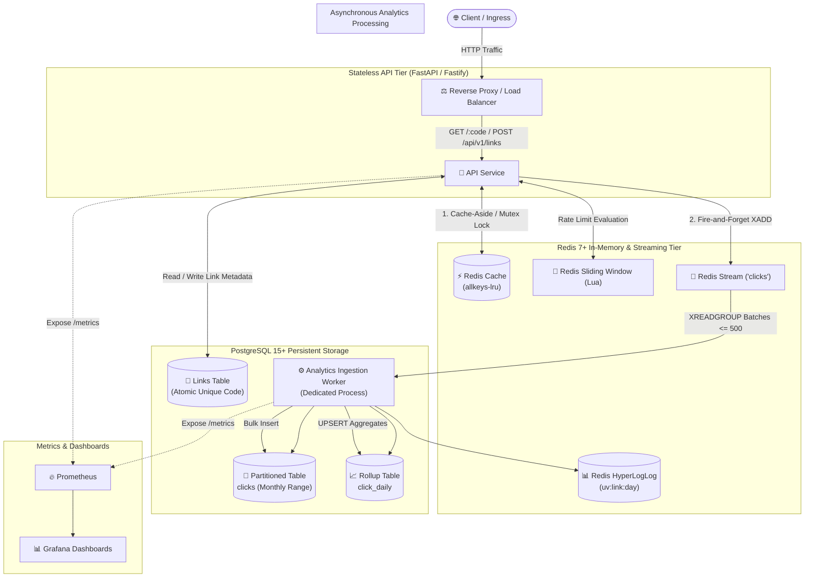
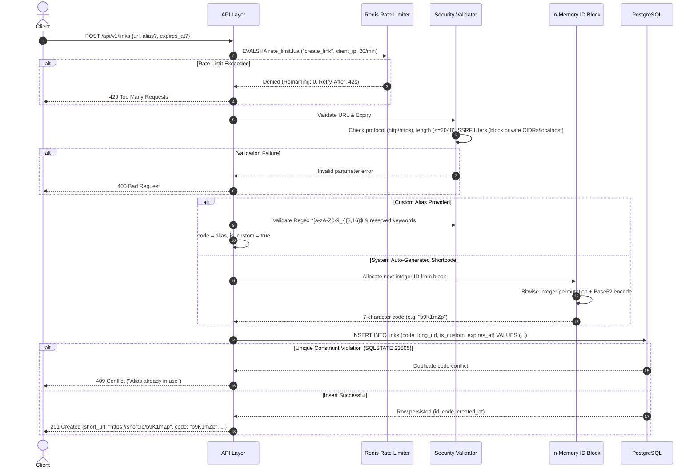
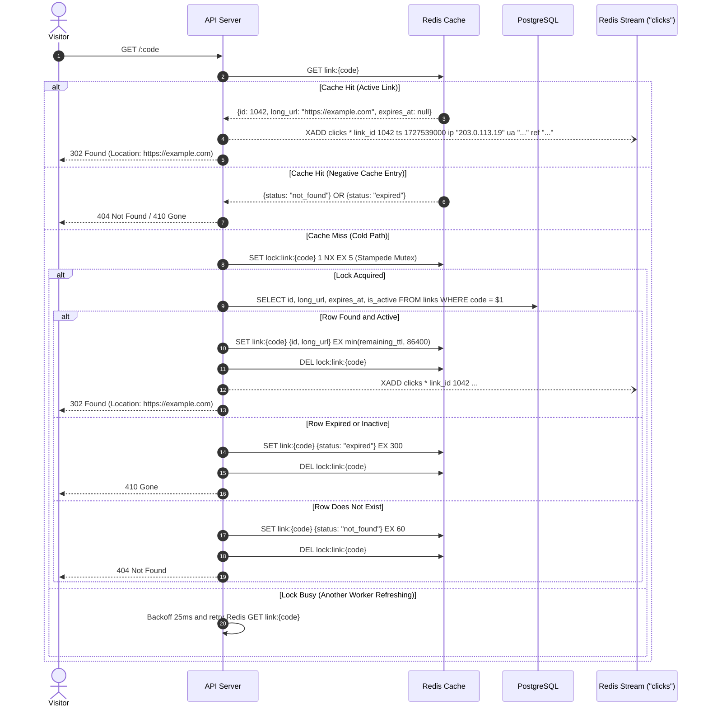
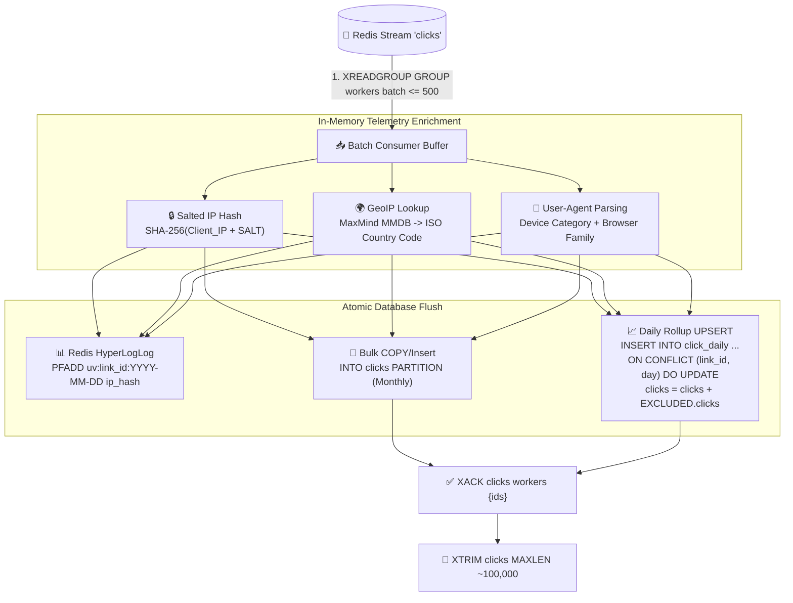
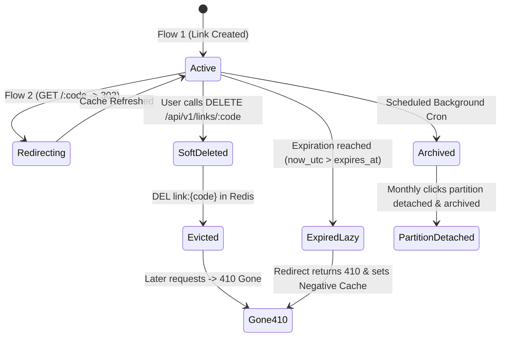

# 🌊 Project Flow: URL Shortener with Real-Time Stream Analytics

An end-to-end architectural, data flow, and lifecycle guide for the high-performance URL shortener and stream analytics platform.

---

## 📑 Table of Contents
1. [Architecture Overview](#1-architecture-overview)
2. [Data Model & Keyspace Design](#2-data-model--keyspace-design)
3. [Flow 1: Link Creation (`POST /api/v1/links`)](#3-flow-1-link-creation-post-apiv1links)
4. [Flow 2: High-Speed Redirect Engine (`GET /:code`)](#4-flow-2-high-speed-redirect-engine-get-code)
5. [Flow 3: Asynchronous Telemetry & Analytics Worker](#5-flow-3-asynchronous-telemetry--analytics-worker)
6. [Flow 4: Analytics & Aggregation Querying (`GET /api/v1/links/:code/stats`)](#6-flow-4-analytics--aggregation-querying-get-apiv1linkscodestats)
7. [Flow 5: Lifecycle, Expiration & Deletion](#7-flow-5-lifecycle-expiration--deletion)
8. [Edge Cases, Resilience & Failure Modes](#8-edge-cases-resilience--failure-modes)
9. [Observability & Monitoring](#9-observability--monitoring)
10. [End-to-End Verification & Testing](#10-end-to-end-verification--testing)

---

## 1. Architecture Overview

The system is architected around a **100:1 read-to-write ratio**, delivering **sub-50ms p99 redirect latencies** on cache hits while maintaining real-time, non-blocking telemetry ingestion.



---

## 2. Data Model & Keyspace Design

### 2.1 PostgreSQL Relational Schema

```sql
-- 1. Core Links Table
CREATE TABLE links (
    id           BIGSERIAL PRIMARY KEY,
    code         VARCHAR(16) UNIQUE NOT NULL,      -- Unique shortcode or custom alias
    long_url     TEXT NOT NULL,                     -- Validated target destination URL
    is_custom    BOOLEAN DEFAULT FALSE,             -- True if provided by user
    user_id      BIGINT,                            -- Optional owner ID
    created_at   TIMESTAMPTZ NOT NULL DEFAULT now(),
    expires_at   TIMESTAMPTZ,                       -- NULL = indefinite lifetime
    is_active    BOOLEAN NOT NULL DEFAULT TRUE
);
CREATE INDEX idx_links_user ON links(user_id, created_at DESC);
CREATE INDEX idx_links_expiry ON links(expires_at) WHERE expires_at IS NOT NULL AND is_active = TRUE;

-- 2. Raw Telemetry Partitioned by Month on Event Timestamp
CREATE TABLE clicks (
    id         BIGSERIAL,
    link_id    BIGINT NOT NULL,
    ts         TIMESTAMPTZ NOT NULL,
    ip_hash    CHAR(64),                           -- Salted SHA-256 (Never raw IP)
    country    VARCHAR(2) DEFAULT 'XX',            -- ISO country code
    device     VARCHAR(16) DEFAULT 'desktop',      -- desktop / mobile / tablet / bot
    browser    VARCHAR(32) DEFAULT 'Other',        -- Chrome, Safari, Firefox, etc.
    referrer   TEXT                                -- Source HTTP referer header
) PARTITION BY RANGE (ts);

-- Pre-created monthly partitions and fallback default partition
CREATE TABLE clicks_default PARTITION OF clicks DEFAULT;

-- 3. Daily Pre-Aggregated Rollups for O(1) Dashboard Queries
CREATE TABLE click_daily (
    link_id          BIGINT NOT NULL,
    day              DATE NOT NULL,
    clicks           INT NOT NULL DEFAULT 0,
    unique_visitors  INT NOT NULL DEFAULT 0,
    PRIMARY KEY (link_id, day)
);
```

### 2.2 Redis Keyspace Design

| Key Pattern | Data Structure | TTL | Purpose |
|---|---|---|---|
| `link:{code}` | String (JSON) | $\min(\text{remaining\_ttl}, 24\text{h})$ | Cache-aside entry `{id, long_url, expires_at}` |
| `link:{code}` (Negative) | String (JSON) | 60s (404) / 300s (410) | Prevents repeated DB hits on invalid/expired codes |
| `lock:link:{code}` | String | 5s | Distributed mutex preventing cache stampede on cache miss |
| `clicks` | Stream | Maxlen ~100k | Append-only event queue ingested by consumer groups |
| `uv:{link_id}:{YYYY-MM-DD}` | HyperLogLog | 48 hours | Space-efficient unique visitor estimation per day |
| `rate:{endpoint}:{ip}:{window}` | Sorted Set / Hash | 60s | Sliding window rate limiting counter evaluated via Lua |

---

## 3. Flow 1: Link Creation (`POST /api/v1/links`)

Creates a shortened URL with support for custom aliases and expiration timestamps.



### Key Engineering Decisions:
1. **SSRF Guard**: Resolves DNS before acceptance; rejects loopback (`127.0.0.1`), link-local (`169.254.169.254`), and RFC 1918 private ranges (`10.0.0.0/8`, `172.16.0.0/12`, `192.168.0.0/16`).
2. **Atomic Collision Handling**: Never uses check-then-insert. Relies entirely on PostgreSQL's atomic unique index.
3. **Reversible Scrambling**: Monotonic IDs pass through a Feistel/multiplicative modular inverse scramble before Base62 encoding to prevent shortcode enumeration.

---

## 4. Flow 2: High-Speed Redirect Engine (`GET /:code`)

The primary hot path designed for extreme throughput and sub-50ms p99 latency.



### Critical Rules:
* **HTTP 302 vs 301**: We use `302 Found` (temporary redirect) so browsers re-query the service on every visit, ensuring 100% accurate click analytics.
* **Fire-and-Forget Streaming**: `XADD` is performed concurrently or non-blockingly; redirect responses never wait for disk flushes or telemetry operations.
* **Stampede Protection**: `SET ... NX EX 5` ensures that if a viral link expires from cache, only 1 request queries Postgres while others wait on cache.

---

## 5. Flow 3: Asynchronous Telemetry & Analytics Worker

Processes raw click events out-of-band to ensure zero latency impact on the user redirect path.



### Worker Lifecycle & Guarantees:
1. **Batching**: The worker blocks on `XREADGROUP` with `BLOCK 2000` (2s timeout) or flushes as soon as 500 records accumulate.
2. **Privacy**: IP addresses are hashed using a secret salt immediately upon receipt. Raw IPs are never written to disk or logs.
3. **At-Least-Once Delivery & Idempotency**:
   - `XACK` occurs only after both PostgreSQL transactions commit successfully.
   - If the worker crashes mid-batch, unacknowledged records remain in Redis Pending Entries List (`PEL`) and are claimed by recovery workers via `XAUTOCLAIM`.

---

## 6. Flow 4: Analytics & Aggregation Querying (`GET /api/v1/links/:code/stats`)

Provides low-latency access to aggregate statistics and time series data without table scans.

```mermaid
flowchart LR
    Req["GET /api/v1/links/:code/stats\n?from=2026-09-01&to=2026-09-28"] --> Router{"Time Horizon"}

    Router -->|Historical Day Aggregates| RollupQuery["Query 'click_daily' Table\nO(days) - Fast Index Scan"]
    Router -->|Dimension Breakdowns\n(Devices, Browsers, Referrers, Countries)| PartitionQuery["Query 'clicks' Partition\nFiltered by (link_id, ts)"]

    RollupQuery & PartitionQuery --> Merge["⚡ In-Memory Merger"]
    Merge --> Response["200 OK Response\n{\n  'total_clicks': 14820,\n  'unique_visitors': 9430,\n  'time_series': [...],\n  'top_countries': [...],\n  'top_devices': [...],\n  'top_referrers': [...]\n}"]
```

### Query Execution Strategy:
* **Pre-Aggregated Days**: Requests spanning weeks or months read directly from `click_daily`, keeping latency under 10ms.
* **Partition Pruning**: Queries for raw dimensional breakdowns prune unneeded monthly partitions using PostgreSQL range constraints on `ts`.

---

## 7. Flow 5: Lifecycle, Expiration & Deletion



### Deletion and Cleanup Policies:
1. **Soft Deletion (`DELETE /api/v1/links/:code`)**:
   - Requires `ADMIN_API_KEY` (via `X-API-Key` or `Authorization: Bearer <key>`) when configured in production; returns `401 Unauthorized` if invalid.
   - `UPDATE links SET is_active = FALSE WHERE code = $1;`
   - Explicitly executes `DEL link:{code}` in Redis.
   - Any subsequent redirect request encounters the inactive flag and immediately returns **410 Gone**.
2. **Lazy Expiration Check**:
   - On every redirect lookup, `expires_at` is evaluated. If past, the status is set to `expired` in Redis with a 5-minute TTL.
3. **Partition Maintenance**:
   - Monthly cron job invokes partition manager to create upcoming month partitions (`clicks_YYYY_MM`) before midnight on the 1st of each month.

---

## 8. Security Architecture & Threat Defense

| Threat Vector | Defense Mechanism | Implementation |
|---|---|---|
| **SSRF (Internal Networks)** | Strict schema validation (`http`/`https` only), length check (`<= 2048`), loopback/RFC 1918/link-local/multicast IP address blocking, and DNS pre-resolution validation. | [security.py](file:///c:/Users/ASUS/OneDrive/Desktop/URL%20Shortener%20with%20Analytics/app/security.py) |
| **Phishing / Open Redirect Chaining** | Blacklists chained popular shorteners (`bit.ly`, `tinyurl.com`, `t.co`, etc.) preventing attackers from nesting redirects to hide malware destinations. | [security.py](file:///c:/Users/ASUS/OneDrive/Desktop/URL%20Shortener%20with%20Analytics/app/security.py) |
| **Malware Delivery** | Blocks URLs ending in dangerous executable or script extensions (`.exe`, `.msi`, `.bat`, `.sh`, `.vbs`, etc.). | [security.py](file:///c:/Users/ASUS/OneDrive/Desktop/URL%20Shortener%20with%20Analytics/app/security.py) |
| **Credential Phishing** | Rejects target URLs containing embedded credentials (`user:pass@host`). | [security.py](file:///c:/Users/ASUS/OneDrive/Desktop/URL%20Shortener%20with%20Analytics/app/security.py) |
| **IP Spoofing & Rate Limit Bypass** | Only trusts `X-Forwarded-For` from configured `TRUSTED_PROXIES` (e.g. reverse proxy); rejects spoofed client headers from untrusted origins. | [rate_limiter.py](file:///c:/Users/ASUS/OneDrive/Desktop/URL%20Shortener%20with%20Analytics/app/rate_limiter.py) |
| **Clickjacking / MIME Sniffing / XSS** | HTTP response hardening: `X-Content-Type-Options: nosniff`, `X-Frame-Options: DENY`, `Referrer-Policy: strict-origin-when-cross-origin`, and `Content-Security-Policy`. | [main.py](file:///c:/Users/ASUS/OneDrive/Desktop/URL%20Shortener%20with%20Analytics/app/main.py) |
| **Unauthorized Deletion** | Supports `ADMIN_API_KEY` authentication for `DELETE /api/v1/links/:code` via `X-API-Key` or `Bearer` tokens. | [links.py](file:///c:/Users/ASUS/OneDrive/Desktop/URL%20Shortener%20with%20Analytics/app/routes/links.py) |
| **Analytics Query DoS** | Bounds time range parameter span on `/stats` to `MAX_STATS_RANGE_DAYS` (365 days max) and validates `start <= end`. | [stats.py](file:///c:/Users/ASUS/OneDrive/Desktop/URL%20Shortener%20with%20Analytics/app/routes/stats.py) |
| **IP Privacy (GDPR)** | Never logs or stores raw client IPs; applies salted SHA-256 (`hash_ip`) before persistence. | [security.py](file:///c:/Users/ASUS/OneDrive/Desktop/URL%20Shortener%20with%20Analytics/app/security.py) |
| **SQL Injection** | Exclusively uses parameterized queries (`$1`, `$2`) with `asyncpg`. | All Database Operations |

---

## 9. Edge Cases, Resilience & Failure Modes

| Component Failure | Consequence | Mitigation Strategy |
|---|---|---|
| **PostgreSQL Outage** | Write paths (`POST /api/v1/links`) fail with 503. | **Warm redirects continue uninterrupted.** Cached keys in Redis continue serving 302 redirects without contacting PostgreSQL. |
| **Redis Outage** | Cache misses occur; Stream ingestion pauses. | **Fail-Open Policy:** Redirect path catches Redis connection exceptions, falls back to direct PostgreSQL reads, and skips the stream append. |
| **Worker Crash** | Redis Stream buffer accumulates click events. | Stream retains events up to `MAXLEN 100,000`. On restart, worker resumes from last un-ACKed message via `XREADGROUP` / `XAUTOCLAIM`. |
| **Cache Stampede (Thundering Herd)** | Cache key for a viral link expires while under heavy load. | **Distributed Lock:** Only the single request that acquires `lock:link:{code}` queries PostgreSQL; all concurrent requests await cache release. |
| **Alias Collision Race Condition** | Two users submit the same custom alias at the exact same millisecond. | Avoids check-then-insert. Both issue `INSERT INTO links`. PostgreSQL's atomic unique index grants one and throws `23505 UniqueViolation` to the other, which returns **409 Conflict**. |

---

## 9. Observability & Monitoring

The system exposes metrics formatted for Prometheus scraping at `GET /metrics`:

| Metric Name | Type | Labels | Purpose |
|---|---|---|---|
| `redirect_latency_seconds` | Histogram | `cache_status` (hit, miss) | Measures redirect execution times across warm and cold paths |
| `redirect_cache_operations_total` | Counter | `status` (hit, miss) | Tracks cache hit ratio ($\frac{\text{hits}}{\text{hits} + \text{misses}} \ge 98\%$) |
| `http_requests_total` | Counter | `method`, `endpoint`, `status` | Global request rate, 4xx client errors, and 5xx server errors |
| `clicks_stream_lag` | Gauge | `consumer_group` | Measures unprocessed click events in Redis Stream |

---

## 10. End-to-End Verification & Testing

### 10.1 Automated Test Suites
Run the full test suite using pytest:
```bash
.venv/Scripts/pytest -v
```

### 10.2 Load Testing with k6
Simulate high-throughput traffic and assert p99 performance targets:
```bash
# Verify warm cache redirect performance (Target: 5,000+ RPS, p99 < 50ms)
k6 run k6/redirect_warm_cache.js

# Verify cold cache / stampede resilience under concurrent load
k6 run k6/redirect_cold_cache.js
```
