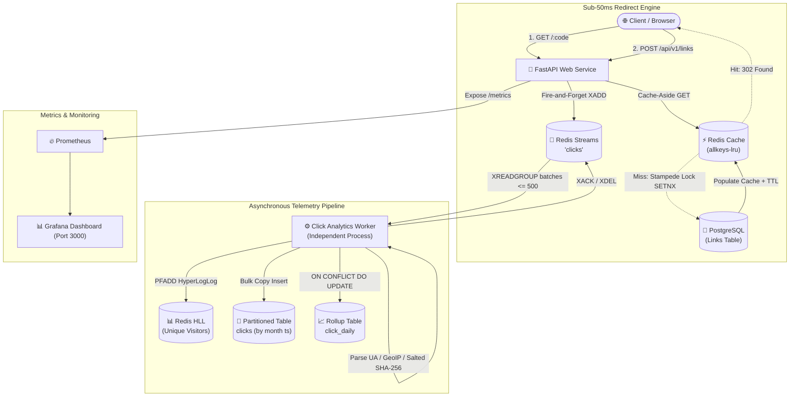

# ⚡ PulseLink: Production-Grade URL Shortener & Stream Analytics

A high-performance, fault-tolerant URL shortener and real-time analytics engine engineered for a **100:1 read-to-write ratio**, sub-**50ms p99 redirect latencies**, and resilient distributed stream processing.


> 📘 **Project Flow Documentation**: For an in-depth walkthrough of all system flows, sequence diagrams, failure recovery, and architectural specifications, see [PROJECT_FLOW.md](file:///c:/Users/ASUS/OneDrive/Desktop/URL%20Shortener%20with%20Analytics/PROJECT_FLOW.md).

---

## 🏗️ 1. Architecture Overview



---

## 🛠️ 2. Technology Stack

| Layer | Choice | Rationale & Tradeoffs |
|---|---|---|
| **API** | **Python (FastAPI + Asyncpg)** | Async I/O, native coroutines, Pydantic v2 validation, OpenAPI autodocs. |
| **Database** | **PostgreSQL 16** | Strong ACID constraints (atomic unique index for collision handling), range-partitioned clicks, UPSERT daily rollups. |
| **Cache / Queue / Limiter** | **Redis 7** | Cache-aside (`allkeys-lru`), distributed mutex lock (stampede protection), Lua atomic sliding-window rate limiting, Streams (`XADD`/`XREADGROUP`), and HyperLogLog (`PFADD`). |
| **Worker** | **Python (Separate Process)** | Decouples analytics processing from the critical redirect path; bulk inserts raw events and maintains rollups. |
| **Infra** | **Docker Compose** | One-command local orchestration for DB, Redis, API, Worker, Prometheus, and Grafana. |
| **Load Testing** | **k6** | Simulates 5,000+ RPS to verify p99 < 50ms under warm and cold cache scenarios. |

---

## 📐 3. Data Model

### PostgreSQL Schema (`migrations/001_initial_schema.sql`)

```sql
-- Core Links table
CREATE TABLE links (
    id           BIGSERIAL PRIMARY KEY,
    code         VARCHAR(16) UNIQUE NOT NULL,   -- Short code or custom alias
    long_url     TEXT NOT NULL,
    is_custom    BOOLEAN DEFAULT FALSE,
    user_id      BIGINT,                        -- Nullable for anonymous links
    created_at   TIMESTAMPTZ NOT NULL DEFAULT now(),
    expires_at   TIMESTAMPTZ,                   -- NULL = never expires
    is_active    BOOLEAN NOT NULL DEFAULT TRUE
);
CREATE INDEX idx_links_user ON links(user_id, created_at DESC);
CREATE INDEX idx_links_expiry ON links(expires_at) WHERE expires_at IS NOT NULL;

-- Raw Clicks table (Partitioned by Range on 'ts')
CREATE TABLE clicks (
    id         BIGSERIAL,
    link_id    BIGINT NOT NULL,
    ts         TIMESTAMPTZ NOT NULL,
    ip_hash    CHAR(64),
    country    VARCHAR(2) DEFAULT 'XX',
    device     VARCHAR(16) DEFAULT 'desktop',
    browser    VARCHAR(32) DEFAULT 'Other',
    referrer   TEXT
) PARTITION BY RANGE (ts);

-- Default and monthly partition tables
CREATE TABLE clicks_default PARTITION OF clicks DEFAULT;
CREATE TABLE clicks_2026_09 PARTITION OF clicks
    FOR VALUES FROM ('2026-09-01 00:00:00+00') TO ('2026-10-01 00:00:00+00');

-- Pre-aggregated rollups for instant dashboard queries
CREATE TABLE click_daily (
    link_id          BIGINT NOT NULL,
    day              DATE NOT NULL,
    clicks           INT NOT NULL DEFAULT 0,
    unique_visitors  INT NOT NULL DEFAULT 0,
    PRIMARY KEY (link_id, day)
);
```

> **Race-Free Alias Collision:** The unique index on `code` is the atomic source of truth. We catch `UniqueViolationError` directly on insert rather than check-then-insert (which is susceptible to race conditions under concurrent writes).

---

## 🧮 4. Short Code Generation: Counter + Feistel + Base62

Instead of sequential guessable codes (`abc1`, `abc2`), PulseLink uses a **4-round Format-Preserving Feistel Cipher with cycle-walking** over a domain of $62^7 \approx 3.52 \text{ trillion}$ codes:

1. **Auto-Increment Sequence**: PostgreSQL sequence `links_id_seq` provides conflict-free distributed IDs.
2. **Reversible Permutation (Feistel Network)**: Sequential integers are transformed through 4 non-linear mixing rounds into pseudo-random integers within $[0, 62^7)$.
3. **Base62 Encoding**: The scrambled integer is encoded using `0-9a-zA-Z`.
4. **Collision Guarantee**: Because the Feistel cipher is a bijective permutation, there are **zero collisions** across all 3.52 trillion generated codes.

---

## 🚀 5. Redirect Engine & Caching (< 50ms p99)

- **HTTP 302 Found**: We intentionally use `302 Found` (not `301 Moved Permanently`). A `301` would be cached by client browsers, which bypasses the shortener, breaks real-time click counting, and prevents enforcing expiration or link deactivation.
- **Cache-Aside TTL**: `TTL = min(time until expires_at, 24h)`. Dead or expired links are never served from stale cache.
- **Negative Caching**: Non-existent codes (`404`) and disabled codes (`410`) are cached in Redis with a 60-second TTL to shield PostgreSQL from cache-penetration attacks.
- **Stampede / Dogpiling Protection**: When a popular key misses cache, a distributed mutex lock (`SET lock:link:{code} 1 NX EX 5`) ensures only 1 worker queries PostgreSQL while concurrent requests await cache population.
- **Fail-Open Policy**: If Redis temporarily drops connection during a redirect, the service fails open to PostgreSQL to maximize availability.

---

## 📊 6. Click Analytics Pipeline

1. **Non-Blocking Ingestion**: The redirect handler pushes raw request telemetry to Redis Streams via `XADD clicks *` as a non-blocking background task.
2. **Batch Processing**: The separate worker process polls using consumer groups (`XREADGROUP GROUP click_workers ...`) in batches of up to **500 events** or every **1–2 seconds**.
3. **Data Enrichment**:
   - **User-Agent Parsing**: Classifies device (`mobile`, `desktop`, `tablet`, `bot`) and browser family.
   - **IP Anonymization**: Hashes client IP using salted `SHA-256` for GDPR/privacy compliance.
   - **GeoIP Resolution**: Resolves country code.
4. **Partitioned Bulk Insert**: Ingests raw events in a single PostgreSQL transaction.
5. **Daily Rollup Aggregation**: Executes atomic upserts (`INSERT ... ON CONFLICT (link_id, day) DO UPDATE SET clicks = click_daily.clicks + EXCLUDED.clicks`).
6. **Unique Visitor Estimation**: Uses Redis HyperLogLog (`PFADD hll:{link_id}:{date}`) per link per day to approximate unique visitors in $O(1)$ memory.

---

## 🛡️ 7. Rate Limiting & Abuse Prevention

PulseLink implements a sliding-window rate limiter via atomic Redis Lua scripts (`ZREMRANGEBYSCORE` + `ZCARD` + `ZADD`):

- **Link Creation**: Strict limit of **20 requests/minute per IP** (fails closed).
- **Redirects**: Looser limit of **300 requests/minute per IP** (fails open).
- **SSRF Protection**: Validates protocols (only `http` and `https`), blocks loopback (`127.0.0.1`, `::1`), private ranges (`10.0.0.0/8`, `172.16.0.0/12`, `192.168.0.0/16`, `169.254.0.0/16`), and blocks links pointing back to self-domain.
- **Custom Alias Sanitization**: Requires `^[a-zA-Z0-9_-]{3,16}$` and blocks reserved keywords (`api`, `admin`, `health`, `metrics`, `docs`, etc.).

---

## 📡 8. API Specification

### 1. Shorten a URL
```bash
curl -X POST http://localhost:8000/api/v1/links \
  -H "Content-Type: application/json" \
  -d '{
    "url": "https://news.ycombinator.com",
    "alias": "hackernews",
    "expires_at": "2026-12-31T23:59:59Z"
  }'
```
**Response (`201 Created`):**
```json
{
  "code": "hackernews",
  "short_url": "http://localhost:8000/hackernews",
  "long_url": "https://news.ycombinator.com",
  "is_custom": true,
  "created_at": "2026-09-28T14:50:00Z",
  "expires_at": "2026-12-31T23:59:59Z",
  "is_active": true
}
```

### 2. Redirect
```bash
curl -i http://localhost:8000/hackernews
```
**Response (`302 Found`):**
```http
HTTP/1.1 302 Found
Location: https://news.ycombinator.com
X-Cache: HIT
X-Response-Time: 0.85ms
```

### 3. Get Real-Time Analytics
```bash
curl http://localhost:8000/api/v1/links/hackernews/stats
```

### 4. Generate QR Code
```bash
curl http://localhost:8000/api/v1/links/hackernews/qr --output qr.png
```

### 5. Disable / Delete Link
```bash
curl -X DELETE http://localhost:8000/api/v1/links/hackernews
```

---

## ⚡ 9. Running with Docker Compose

To launch the full system (PostgreSQL, Redis, FastAPI, Worker, Prometheus, Grafana):

```bash
docker compose up --build -d
```

### Services Access:
- **Web Dashboard & Shortener UI**: [http://localhost:8000](http://localhost:8000)
- **Interactive Swagger Docs**: [http://localhost:8000/docs](http://localhost:8000/docs)
- **Prometheus Metrics**: [http://localhost:8000/metrics](http://localhost:8000/metrics)
- **Prometheus UI**: [http://localhost:9090](http://localhost:9090)
- **Grafana Dashboards**: [http://localhost:3000](http://localhost:3000) *(User: `admin`, Pass: `admin`)*

---

## 🧪 10. Verification & Load Testing (k6)

### Run Unit & Integration Tests:
```bash
.venv\Scripts\pytest -v
```

### Run k6 Load Benchmark (Verifying p99 < 50ms):
```bash
k6 run -e TARGET_URL=http://localhost:8000 k6/load_test.js
```

---

## 💼 11. Interview Talking Points & Capacity Math

- **Write Capacity**: $100\text{M}$ new links/month $\approx 40$ writes/sec. PostgreSQL can effortlessly handle $2,000+$ writes/sec on a modest instance.
- **Read Capacity**: At a $100:1$ read-to-write ratio, average load is $\sim 4,000$ reads/sec, peaking at $40,000+$ reads/sec. With a Redis hit ratio $> 98\%$, Redis handles $\approx 39,200$ reads/sec in-memory with sub-millisecond response times.
- **Storage**: At $\sim 500$ bytes per link row, $100\text{M}$ links consume $\approx 50\text{ GB/month}$ raw link data.
- **Click Storage**: Range-partitioned monthly tables enable instant dropping or archiving of historical data without costly `DELETE` vacuum overheads.
- **Extreme Scale Evolution**:
  - Replace Redis Streams with Apache Kafka for multi-region event streaming.
  - Offload historical raw click event storage from PostgreSQL to ClickHouse or TimescaleDB.
  - Implement an in-process LRU cache (e.g. `lru-cache`) in front of Redis to absorb super-viral links.
