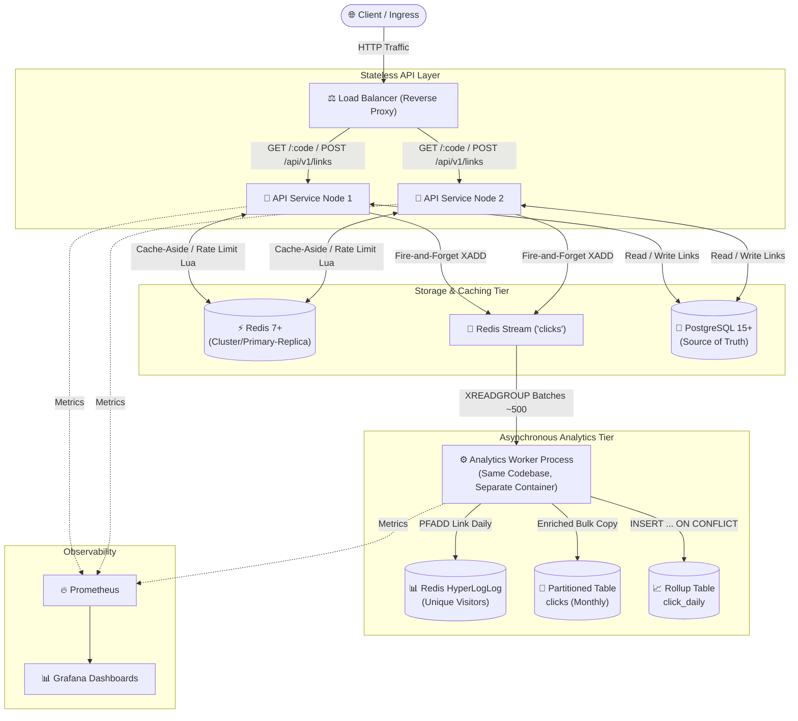
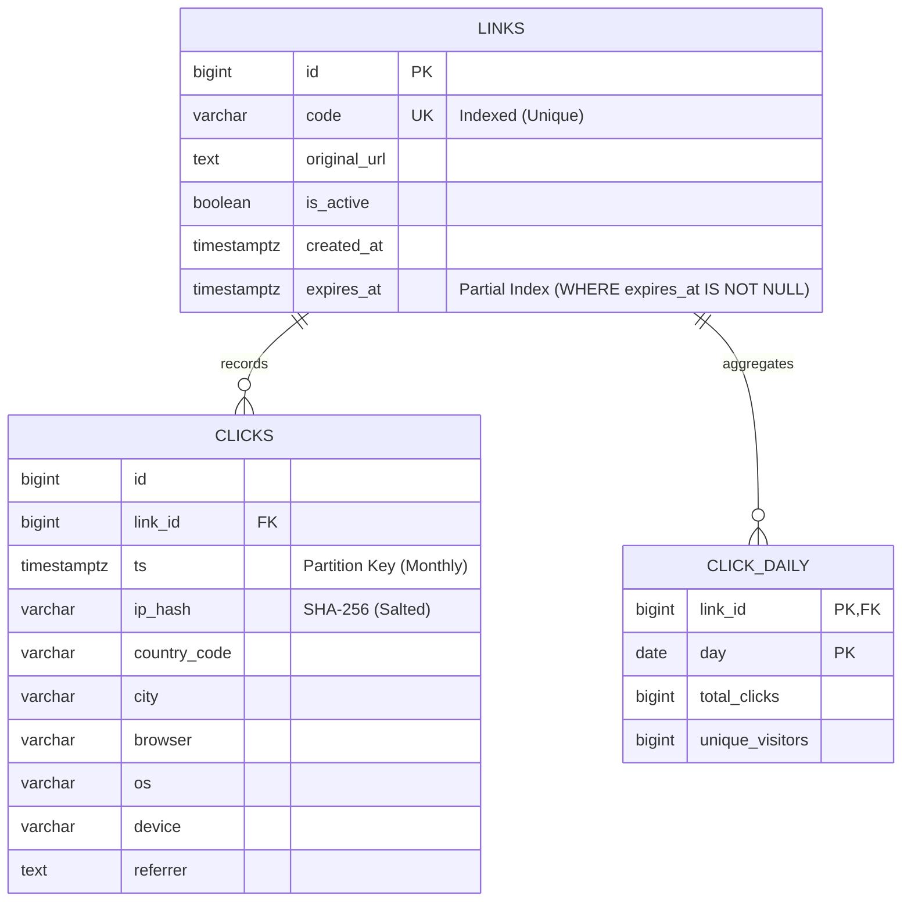
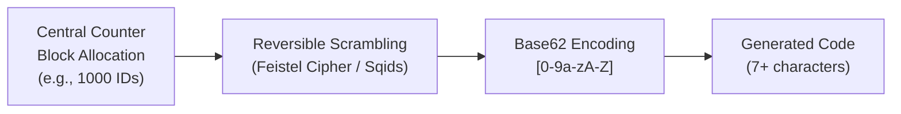
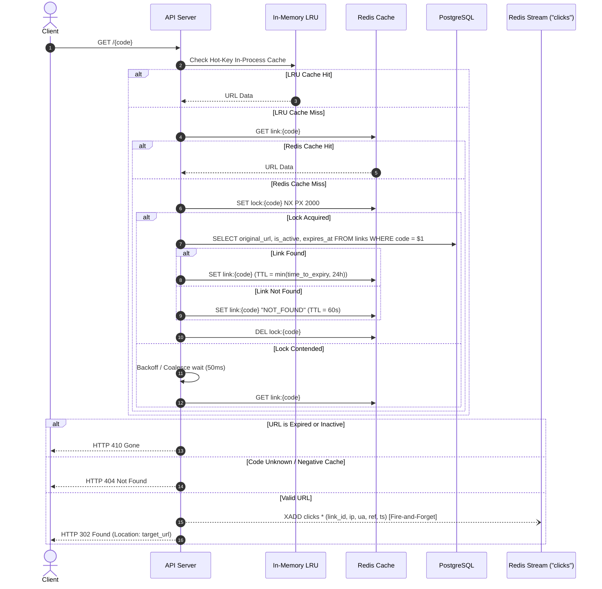
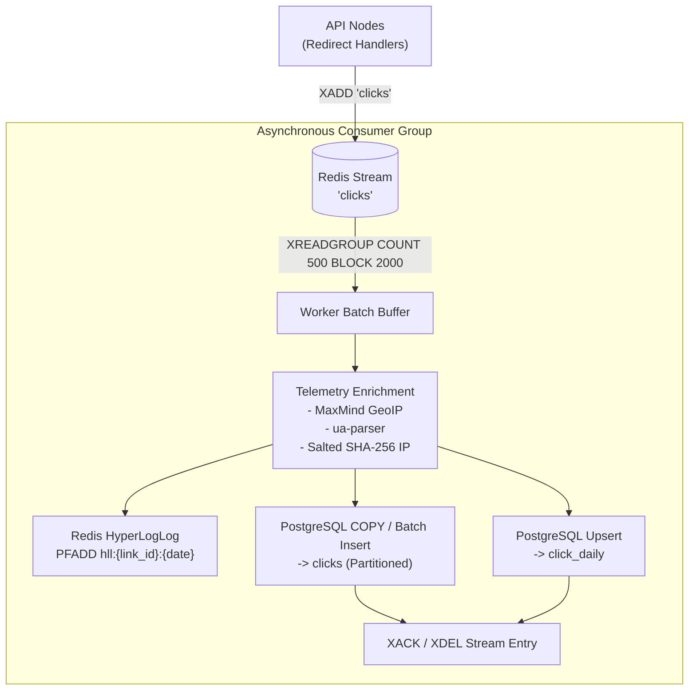
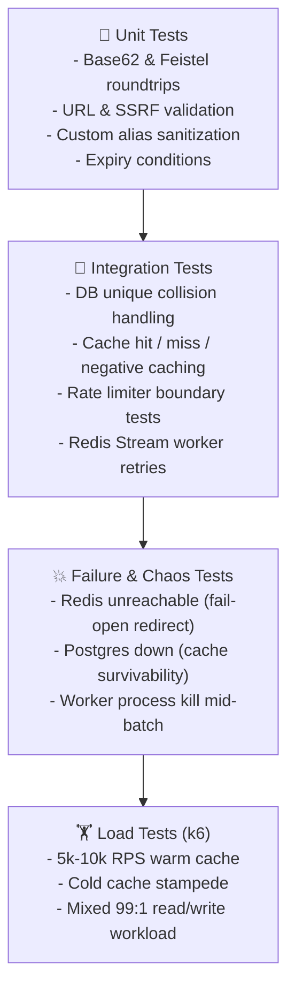

# 📋 Technical Requirements Document (TRD)
## High-Performance URL Shortener with Real-Time Stream Analytics

---

## 1. Architecture

The system is designed as an ultra-low latency, highly available, distributed URL shortener and stream analytics platform built for high read-to-write ratios (100:1).



### Architectural Principles
* **Stateless API Service**: API instances maintain zero in-memory application state; any instance can serve any incoming request behind a standard load balancer.
* **PostgreSQL as Source of Truth**: Relational consistency, transactional guarantees, and partitioned storage for link metadata, raw telemetry events, and aggregate rollups.
* **Redis Multi-Purpose Tier**:
  * **Cache-aside** layer for fast short-code resolution.
  * **Atomic rate limiting** using sliding window Lua scripts.
  * **Click-event streaming broker** using Redis Streams.
  * **HyperLogLog cardinality tracking** for real-time unique visitor estimation.
* **Decoupled Worker Process**: Telemetry is consumed out-of-band by a dedicated background worker process sharing the same codebase, ensuring the critical redirect path is non-blocking.
* **Local Orchestration & Migrations**: Entire stack boots deterministically via Docker Compose. Database schema versions are tracked and applied using robust migration tooling (e.g., Alembic / Flyway / Knex / SQL-based versioned migrations).

---

## 2. Technology Requirements

| Component | Technology | Specification / Rationale |
|---|---|---|
| **API Framework** | Fastify (Node.js), FastAPI (Python), or Go | Must support native asynchronous I/O and non-blocking event loops. |
| **Primary Database** | PostgreSQL 15+ | Declarative table partitioning by range (monthly), partial indexes, upserts. |
| **Cache & Queue** | Redis 7+ | Redis Streams (`XADD`, `XREADGROUP`), Lua scripting for atomic locks & limiters, HyperLogLog (`PFADD`, `PFCOUNT`). |
| **GeoIP Engine** | MaxMind GeoLite2 | Local offline binary MMDB file (`GeoLite2-City.mmdb`) for zero-network-hop geolocation resolution. |
| **User Agent Parser** | `ua-parser` or equivalent | Fast in-memory parsing of browser family, OS, and device categories. |
| **Observability** | Prometheus, Grafana, Structured JSON | `/metrics` endpoint scrapable by Prometheus; Grafana visualization; machine-readable JSON logs. |
| **Load Testing** | k6 | Scriptable synthetic benchmarks verifying p99 latencies, cache hit/miss behavior, and stress concurrency. |

---

## 3. Data Requirements

### 3.1 Relational Schema & Indexing



### 3.2 Indexing & Integrity Rules
* **Link Code Index**: `links.code` has a strict `UNIQUE` B-Tree index. Alias collisions are strictly handled by catching the unique constraint violation (`23505` unique violation) rather than checking existence prior to insertion (eliminating race conditions).
* **Expiry Partial Index**: 
  ```sql
  CREATE INDEX idx_links_expires_at ON links (expires_at) 
  WHERE expires_at IS NOT NULL AND is_active = TRUE;
  ```
  Optimizes background vacuuming and cleanup jobs for expired links.
* **Partitioned Clicks Storage**:
  * The `clicks` table is declaratively partitioned by range on timestamp (`ts`) on a **monthly** schedule (`clicks_yYYYYmMM`).
  * Composite index on `(link_id, ts DESC)` per partition for fast analytical filtering.
* **Daily Aggregates Rollup**:
  * `click_daily` table keyed on composite primary key `(link_id, day)`.
  * Incremented via upserts:
    ```sql
    INSERT INTO click_daily (link_id, day, total_clicks, unique_visitors)
    VALUES ($1, $2, $3, $4)
    ON CONFLICT (link_id, day)
    DO UPDATE SET 
        total_clicks = click_daily.total_clicks + EXCLUDED.total_clicks,
        unique_visitors = click_daily.unique_visitors + EXCLUDED.unique_visitors;
    ```
* **Privacy & GDPR Compliance**:
  * Client IP addresses must **never** be stored in raw text.
  * Stored exclusively as salted cryptographic hashes: `SHA-256(client_ip + salt)`.

---

## 4. Code Generation



### 4.1 System-Generated Short Codes
1. **Range Allocation**:
   * API nodes allocate sequential ID blocks in batches of ~1,000 from a central Redis atomic counter or PostgreSQL sequence (`nextval`).
   * Eliminates database round-trips for every link creation.
2. **Reversible Scrambling**:
   * Allocated monotonic IDs are scrambled using a reversible pseudo-random permutation (e.g., 32-bit / 64-bit Feistel cipher or Sqids).
   * Prevents sequential guessing, enumeration attacks, and competitor intelligence gathering.
3. **Base62 Encoding**:
   * Scrambled integer is encoded into Base62 alphabet `[0-9a-zA-Z]`.
   * Padded or transformed to ensure a minimum length of 7 characters (e.g., $62^7 \approx 3.52 \times 10^{12}$ unique permutations).

### 4.2 Custom Aliases
* **Length**: 3 to 16 characters.
* **Allowed Characters**: Regex pattern `^[a-zA-Z0-9_-]{3,16}$` (case-sensitive).
* **Reserved Namespace**: Blacklist checked before persistence (`api`, `admin`, `health`, `metrics`, `static`, `dashboard`, `v1`, `docs`).
* **Concurrency**: Handled via database unique constraint violation handling (`try / catch` on commit).

---

## 5. Redirect Path (Hot Path)

The redirect pipeline is designed for minimum overhead, target p99 < 50ms, and complete non-blocking execution.



### Cache & Fallback Specifications
* **Cache Strategy**: Cache-aside with `link:{code}` key format.
* **TTL Policy**: `TTL = min(time_to_expiry, 24 hours)`. Expired or disabled records return HTTP 410.
* **Negative Caching**: Unknown codes are cached as sentinel values with a short TTL (~60s) to prevent cache penetration / denial-of-service against PostgreSQL.
* **Stampede Protection**: Cache stampede (thundering herd) mitigated via Redis `SETNX` distributed locks with short TTL (2s) or single-flight request coalescing.
* **Memory Management**: Redis configured with `maxmemory-policy allkeys-lru`.
* **Telemetry Decoupling**: Redirect response emits a fire-and-forget `XADD` event to Redis Streams. The client response is sent immediately without waiting for stream acknowledgments or database inserts.

---

## 6. Analytics Pipeline



### 6.1 Stream Consumer Mechanics
* **Producer**: API redirect handler calls `XADD clicks * link_id <id> ip <ip> ua <ua> ref <referer> ts <ts>`.
* **Consumer Group**: Worker instances join a shared consumer group (`cg_analytics`) reading via `XREADGROUP`.
* **Batch Processing**: Workers read batches of up to 500 events or flush every 1–2 seconds.
* **Pending Entries & Retries**: Periodic execution of `XPENDING` / `XCLAIM` to reclaim unacknowledged messages abandoned by crashed workers.
* **At-Least-Once Delivery**: Insert logic is idempotent; bulk writes and rollups are structured to tolerate duplicate event retries.

### 6.2 Data Enrichment & Aggregation
1. **UA Parsing**: Extracts browser family/version, OS family/version, and device type (Desktop, Mobile, Tablet, Bot).
2. **GeoIP Resolution**: Looks up ISO country code and city name via local MaxMind `GeoLite2-City.mmdb`.
3. **Hashing**: Salty one-way SHA-256 hash generated for IP address; raw IP is discarded.
4. **Cardinality Tracking**: Real-time distinct visitor counts tracked in Redis via `PFADD hll:{link_id}:{YYYY-MM-DD} {ip_hash}`.

---

## 7. Rate Limiting

* **Algorithm**: Redis-backed sliding window counter implemented via atomic Lua scripts.
* **Granularity & Limits**:
  * **Link Creation (`POST /api/v1/links`)**: ~20 requests per minute per IP or API key.
  * **Link Redirection (`GET /{code}`)**: ~300 requests per minute per IP.
* **HTTP Headers**:
  * `429 Too Many Requests`
  * `Retry-After: <seconds>`
  * `X-RateLimit-Limit: <limit>`
  * `X-RateLimit-Remaining: <remaining>`
  * `X-RateLimit-Reset: <timestamp>`
* **Fault Tolerance**:
  * **Redirect Route**: Fail-open if Redis encounters connection timeout (avoids dropping user redirects).
  * **Create Route**: Fail-closed if Redis is unavailable to protect the database against denial-of-service attacks.

---

## 8. Security Requirements

* **URL Validation**:
  * Protocol restricted strictly to `http://` and `https://`.
  * Maximum character limit enforced (e.g., 2,048 characters).
* **SSRF Prevention**:
  * Destination URLs are validated against loopback, private IPv4/IPv6 CIDRs, link-local addresses, and cloud metadata endpoints (`169.254.169.254`).
  * Domain DNS resolution checked at time of creation to prevent DNS rebinding attacks.
* **Self-Redirect Loop Defense**:
  * URLs resolving to the shortener's own hostnames, subdomains, or reverse-proxy IP addresses are rejected with HTTP 400.
* **Data Sanitization**:
  * 100% parameterized queries via query builder or ORM/asyncpg driver to eliminate SQL injection.
  * Input schema validation (e.g., Pydantic / Zod) on all payload endpoints.
* **Malicious URL Screening (Optional / Modular)**:
  * Pluggable hook for Google Safe Browsing or Cloudflare Radar API lookups.
* **Secret & Transport Security**:
  * All secrets (database credentials, salts, API keys) supplied via environment variables.
  * Enforced TLS (HTTPS) across external load balancers.

---

## 9. Performance Targets

| Metric | Target Specification |
|---|---|
| **Redirect Latency (p99, Cache Hit)** | `< 50 ms` |
| **Throughput (Warm Cache)** | `5,000 - 10,000 redirects/sec` per single node |
| **Cache Hit Rate** | `> 90%` |
| **Analytics Processing Lag** | `< 5 seconds` from redirect click to rollup availability |
| **Click Event Loss Rate** | `< 0.1%` under peak backpressure |

---

## 10. Reliability and Scaling

### 10.1 Graceful Degradation & High Availability
* **PostgreSQL Failure Tolerance**: If PostgreSQL is offline, redirect endpoints continue serving hot and cached URLs from Redis (`link:{code}`).
* **Worker Backpressure**: If database writes slow down, the Redis Stream acts as a shock absorber. Unprocessed events buffer safely in Redis memory up to configured stream retention policies (`MAXLEN ~ 100,000`).
* **Hot-Key Protection**: In-process LRU cache (e.g., memory cache with 5–10s TTL) placed in front of Redis on API nodes to absorb viral traffic spikes without exhausting Redis bandwidth.

### 10.2 Horizontal & Long-Term Scaling
* **API & Worker Layer**: Stateless container replicas scale horizontally behind load balancers based on CPU/RPS metrics.
* **Redis Scaling**: Upgrade to Redis Cluster sharded by hash slots on `{code}`.
* **Database Scaling**: Read replicas for analytical queries and dashboards.
* **Evolution Path**:
  * Transition click-event streaming to Apache Kafka for multi-region or enterprise scale.
  * Transition long-term analytical telemetry to columnar stores (e.g., ClickHouse or TimescaleDB).

---

## 11. Testing Requirements



### Test Scope
1. **Unit Testing**:
   * Scramble and Base62 bi-directional symmetry ($f^{-1}(f(x)) = x$).
   * SSRF IP validation (blocking `127.0.0.1`, `10.0.0.0/8`, `169.254.169.254`, `::1`).
   * Custom alias validation (reserved word collision, special characters).
2. **Integration Testing**:
   * Race conditions on simultaneous alias creation.
   * Cache-aside lifecycle: cold miss -> DB query -> cache populate -> warm hit.
   * Lua sliding-window rate limit window expiry and counter resets.
3. **Failure Scenarios**:
   * Simulating Redis partition: verifying fail-open redirects and error handling.
   * Simulating PostgreSQL termination: verifying redirects succeed from cache.
   * Killing worker process mid-stream batch to ensure `XCLAIM` recovers unacknowledged entries without loss.
4. **k6 Load Scenarios**:
   * Warm-cache redirect benchmark: verify p99 < 50ms at 5,000+ RPS.
   * Cache stampede stress test: verify lock contention handles simultaneous misses gracefully.

---

## 12. Observability & Telemetry

### 12.1 Metrics (Prometheus Format)
* `http_requests_total{handler, method, status}`: Request count broken down by status code (2xx, 3xx, 4xx, 5xx).
* `http_request_duration_seconds{handler}`: Latency histogram (p50, p90, p99).
* `cache_operations_total{type="hit|miss|negative"}`: Cache efficiency.
* `stream_lag_events`: Number of unread events pending in `clicks` stream.
* `worker_batch_duration_seconds`: Histogram of worker processing time per batch.
* `worker_batch_size`: Gauge of events processed per cycle.

### 12.2 Structured Logging & Privacy
* Machine-readable structured JSON format with correlated `request_id`.
* PII scrubbing: client IP addresses replaced with salted SHA-256 hash or omitted from access logs.

### 12.3 Alerting Rules
* **p99 Latency Alert**: `http_request_duration_seconds{quantile="0.99"} > 0.050` for > 2 minutes.
* **Error Rate Spike**: 5xx HTTP response rate > 1% of total traffic.
* **Analytics Stream Lag**: Unprocessed stream entries > 10,000 or consumer lag > 60 seconds.
* **DB Connection Saturation**: Active pool connections > 85% of total capacity.

---

## 13. Deployment & Infrastructure

* **Containerization**: Multi-stage Docker builds yielding minimal production container images.
* **Health & Readiness Probes**:
  * `GET /health/live`: Basic process liveness check.
  * `GET /health/ready`: Deep dependency readiness check verifying PostgreSQL and Redis connections.
* **Configuration Management**: 100% 12-Factor App compliance via environment variables:
  * `DATABASE_URL`: PostgreSQL connection string.
  * `REDIS_URL`: Redis host, port, authentication, database number.
  * `BASE_URL`: Domain host for short URL construction.
  * `IP_HASH_SALT`: Cryptographic salt for privacy-preserving IP hashing.
  * `RATE_LIMIT_CREATE`, `RATE_LIMIT_REDIRECT`: Dynamic rate limit quotas.
* **CI/CD Automation Pipeline**:
  * Step 1: Code linting & static analysis (flake8 / ruff / eslint).
  * Step 2: Automated unit & integration test suites.
  * Step 3: Migration validation on test database.
  * Step 4: Container image build, security scan, and artifact publishing.
